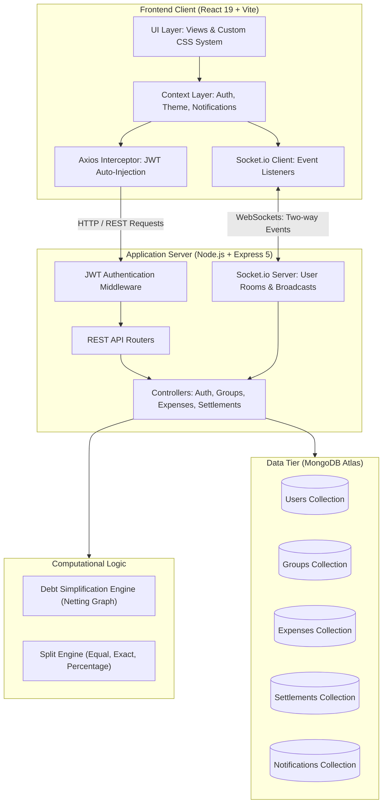
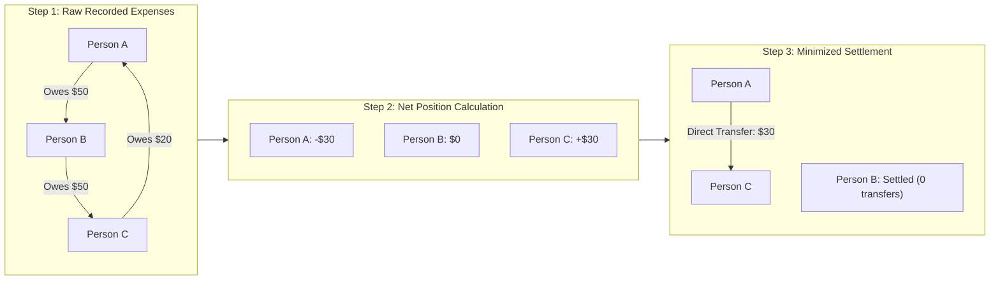
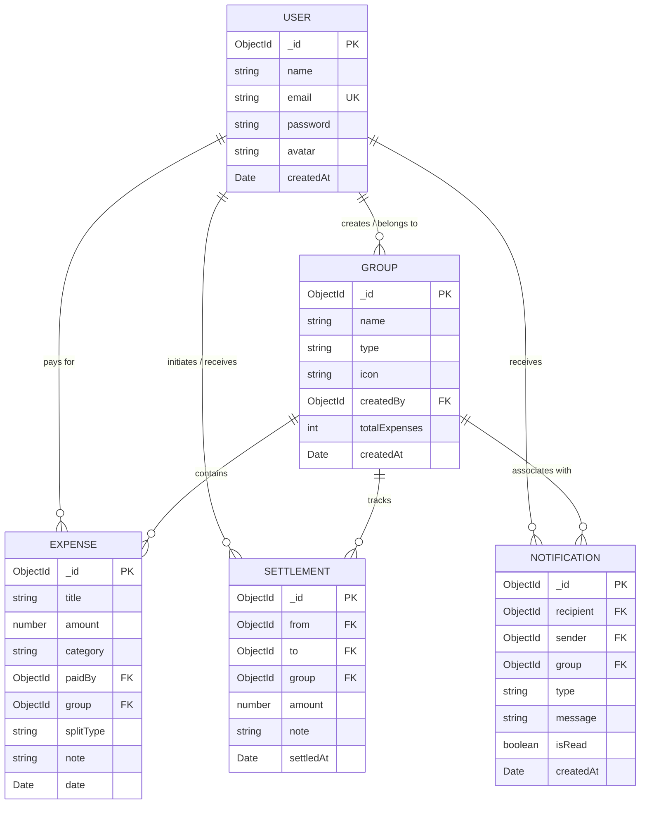

# SplitMate

A collaborative expense-splitting platform designed to track shared costs, calculate multi-party splits, minimize transactions, and synchronize balances in real time.

[](https://react.dev/)
[](https://vitejs.dev/)
[](https://nodejs.org/)
[](https://expressjs.com/)
[](https://www.mongodb.com/)
[](https://socket.io/)
[](LICENSE)

Live Deployment: [https://split-mate-peach.vercel.app](https://split-mate-peach.vercel.app)

---

## Overview

SplitMate manages group financial balances for shared living expenses, trips, dinners, and events. It solves the issue of circular and convoluted debt chains among groups of people by implementing an automated debt-simplification algorithm that minimizes the total number of peer-to-peer payments required to balance accounts.

---

## System Architecture



---

## Debt Simplification Algorithm

When multiple group members pay for various items, circular debts frequently occur (for example: Person A owes Person B, Person B owes Person C, and Person C owes Person A). SplitMate resolves this in $O(N \log N)$ complexity through net position balancing:

1. **Calculate Net Positions**: For each user $i$, compute:
   $$\text{Net}_i = \sum \text{Paid By User}_i - \sum \text{Owed By User}_i$$
2. **Partition Balances**: Separate users into **Creditors** ($\text{Net} > 0$) and **Debtors** ($\text{Net} < 0$).
3. **Greedy Matching**: Repeatedly match the maximum debtor with the maximum creditor, settling the minimum of both values until all balances reach zero.



---

## Data Model & Relationships



---

## Key Capabilities

* **Asymmetric Financial Overview**: Replaced repetitive three-card layouts with a single financial header displaying overall net position alongside owed, owe, and active group counts.
* **Flexible Split Allocation**:
  * **Equal**: Splits totals evenly across all active group participants.
  * **Exact Amounts**: Allocates custom currency amounts with automated validation against total expense cost.
  * **Percentages**: Distributes proportional shares totaling 100%.
* **Real-Time WebSockets**: Live Socket.io room broadcasts trigger instant UI updates when new expenses are logged or debts are marked settled.
* **Granular Categorization**: Expenses categorized under Food, Travel, Rent, Shopping, Entertainment, and Other with vector icons.
* **Data Visualization**: Integrated Recharts components render category expenditure distributions and monthly trend trajectories.
* **Deterministic Color System**: Structured around pure white (`#FFFFFF`) canvas, deep blue interactive elements (`#1A56DB`), teal/mint accents (`#00A99D`), and light gray structural panels (`#F5F7FA`).

---

## REST API Specification

### Authentication & Users
| Method | Endpoint | Description | Auth Required |
|---|---|---|---|
| `POST` | `/api/auth/register` | Register new user account | No |
| `POST` | `/api/auth/login` | Authenticate and obtain JWT token | No |
| `GET` | `/api/users/profile` | Retrieve authenticated user profile | Yes |
| `PUT` | `/api/users/profile` | Update profile information | Yes |
| `PUT` | `/api/users/change-password` | Update account password | Yes |

### Groups
| Method | Endpoint | Description | Auth Required |
|---|---|---|---|
| `GET` | `/api/groups` | List all groups for authenticated user | Yes |
| `POST` | `/api/groups` | Create a new expense group | Yes |
| `GET` | `/api/groups/:id` | Fetch group details and member roster | Yes |
| `POST` | `/api/groups/:id/members` | Add new member by email | Yes |
| `DELETE` | `/api/groups/:id` | Delete group (Admin only) | Yes |

### Expenses & Calculations
| Method | Endpoint | Description | Auth Required |
|---|---|---|---|
| `GET` | `/api/expenses/group/:groupId` | Fetch all expenses for a group | Yes |
| `GET` | `/api/expenses/all` | Fetch user expenses across all groups | Yes |
| `POST` | `/api/expenses` | Record a new expense with split rule | Yes |
| `DELETE` | `/api/expenses/:id` | Remove an expense record | Yes |

### Settlements & Balances
| Method | Endpoint | Description | Auth Required |
|---|---|---|---|
| `GET` | `/api/settlements/group/:groupId/balances` | Calculate and return simplified group debts | Yes |
| `POST` | `/api/settlements` | Record a peer settlement | Yes |
| `GET` | `/api/settlements/group/:groupId/history` | Retrieve settlement transaction history | Yes |

### Statistics & Notifications
| Method | Endpoint | Description | Auth Required |
|---|---|---|---|
| `GET` | `/api/stats/dashboard` | Dashboard metrics, balances, recent activity | Yes |
| `GET` | `/api/stats/category` | Category-level spending distribution | Yes |
| `GET` | `/api/stats/monthly` | Historical monthly expense timeline | Yes |
| `GET` | `/api/notifications` | Fetch notification history | Yes |
| `PUT` | `/api/notifications/:id/read` | Mark individual notification as read | Yes |
| `PUT` | `/api/notifications/read-all` | Mark all notifications read | Yes |

---

## Directory Structure

```
splitmate/
├── client/                     # Frontend Application
│   ├── public/                 # Static vector assets and icons
│   ├── src/
│   │   ├── api/                # Axios API service instances
│   │   ├── components/         # Modular UI architecture
│   │   │   ├── common/         # Layouts, Navbar, Sidebar, BrandLogo
│   │   │   ├── dashboard/      # Financial summary, Charts, ActivityFeed
│   │   │   ├── expenses/       # ExpenseCard, ExpenseForm, CategoryBadge
│   │   │   ├── groups/         # GroupCard, GroupForm, MemberList
│   │   │   ├── notifications/  # NotificationBell, NotificationItem
│   │   │   └── settlements/    # BalanceSummary, SettleUpModal
│   │   ├── context/            # Auth, Theme, and Notification Contexts
│   │   ├── hooks/              # Custom application hooks
│   │   ├── pages/              # Routed view containers
│   │   ├── styles/             # Modular CSS stylesheets
│   │   └── utils/              # Icon utilities and helpers
│   ├── index.html              # Single page application entry point
│   ├── package.json            # Client dependencies and build scripts
│   └── vite.config.js          # Vite build configuration
│
└── server/                     # Backend Application
    ├── config/                 # Database connection and environment config
    ├── controllers/            # Request handlers and business logic
    ├── middleware/             # JWT auth validation, error handlers
    ├── models/                 # Mongoose schemas and relationships
    ├── routes/                 # Express route definitions
    ├── socket/                 # Socket.io room and connection handlers
    ├── utils/                  # Debt simplifier and split calculators
    ├── package.json            # Server dependencies and lifecycle scripts
    └── server.js               # Express application and socket server entry
```

---

## Local Development Setup

### Prerequisites
* Node.js (version 18.0.0 or higher)
* npm (version 9.0.0 or higher)
* MongoDB connection string (local instance or MongoDB Atlas URI)

### 1. Repository Setup
```bash
git clone https://github.com/yugank-rai/SplitMate.git
cd SplitMate
```

### 2. Backend Configuration
Navigate to the server directory and install dependencies:
```bash
cd server
npm install
```

Create a `.env` file in the `server/` directory:
```env
PORT=5000
MONGO_URI=mongodb+srv://<username>:<password>@cluster.mongodb.net/splitmate?retryWrites=true&w=majority
JWT_SECRET=your_jwt_secret_key_here
JWT_EXPIRE=7d
CLIENT_URL=http://localhost:5173
```

Start the development API server:
```bash
npm run dev
# Server listening on http://localhost:5000
```

### 3. Frontend Configuration
In a separate terminal, navigate to the client directory and install dependencies:
```bash
cd ../client
npm install
```

Create a `.env` file in the `client/` directory:
```env
VITE_API_URL=http://localhost:5000/api
VITE_SOCKET_URL=http://localhost:5000
```

Start the Vite development server:
```bash
npm run dev
# Client interface available on http://localhost:5173
```

---

## Deployment Configuration

| Tier | Provider | Configuration |
|---|---|---|
| **Frontend** | Vercel | Build Command: `npm run build`<br>Output Directory: `dist`<br>Framework Preset: Vite |
| **Backend** | Render | Environment: Node<br>Build Command: `npm install`<br>Start Command: `node server.js` |
| **Database** | MongoDB Atlas | Cluster: M0 Free Tier<br>Access: Network IP whitelisted (`0.0.0.0/0`) |

---

## Author & Acknowledgements

Developed by **Yugank Rai**  
Computer Science & Engineering, Indian Institute of Information Technology (IIIT) Bhagalpur  
* GitHub: [@yugank-rai](https://github.com/yugank-rai)  
* LinkedIn: [contactyugankrai](https://linkedin.com/in/contactyugankrai)

---

## License

This project is licensed under the [MIT License](LICENSE).
